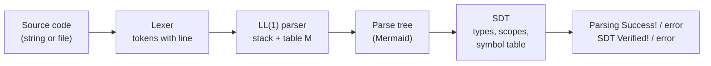
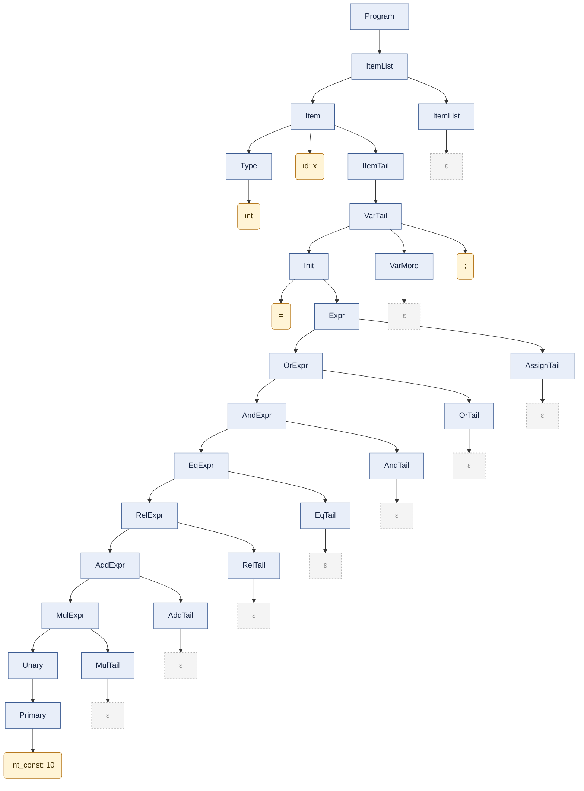
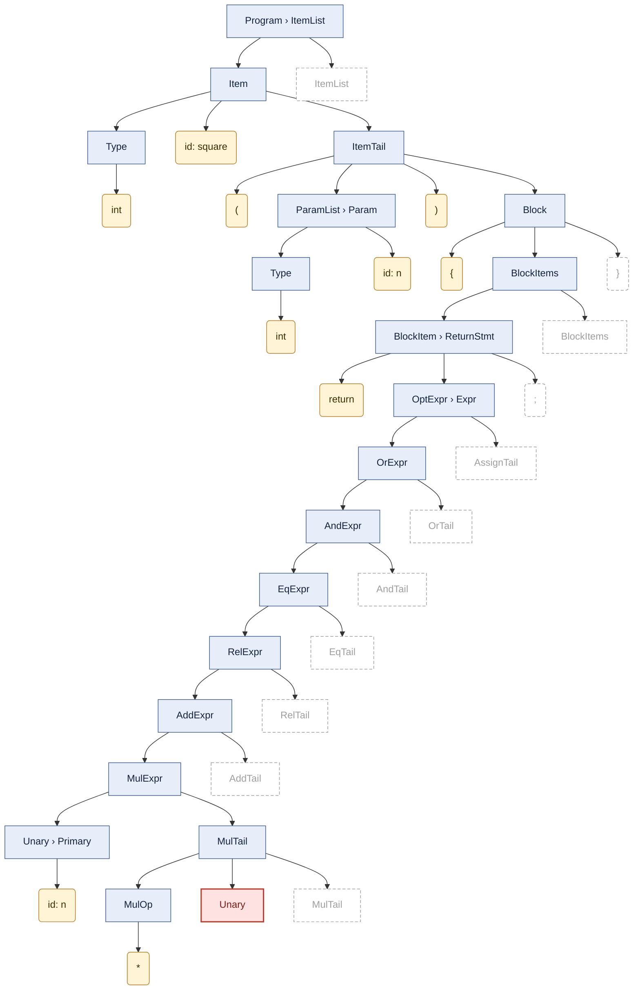

# Syntax and Semantic Analyzer (Parser & SDT) — Compilers

|                |                                                                                                                                                                                                  |
| -------------- | ------------------------------------------------------------------------------------------------------------------------------------------------------------------------------------------------ |
| **University** | Universidad Nacional Autónoma de México (UNAM)                                                                                                                                                   |
| **Faculty**    | Facultad de Ingeniería (Faculty of Engineering)                                                                                                                                                  |
| **Course**     | Compilers, Group 5                                                                                                                                                                               |
| **Team**       | 3                                                                                                                                                                                                |
| **Members**    | Díaz Antúnez David - 424104230<br>Galicia Rodríguez Sofia - 424040127<br>López López Carlos Daniel - 321228631<br>López Morales Fernando Samuel - 321172974<br>Quezada Olivares Emir - 321148836 |
| **Due date**   | November 10th, 2026                                                                                                                                                                              |
| **Web version** | https://cuervy117.github.io/Compiladores/                                                                                                                                                       |

> This is the report of the second deliverable (parser + SDT). The report of the first deliverable (lexer) is kept in [`archive/01-lexer/README.md`](archive/01-lexer/README.md).

## Table of Contents

1. [Introduction and Objective](#1-introduction-and-objective)
2. [Chosen Approach: Why an LL(1) Parser](#2-chosen-approach-why-an-ll1-parser)
3. [Architecture and Project Structure](#3-architecture-and-project-structure)
4. [From Tokens to Terminals](#4-from-tokens-to-terminals)
5. [Context-Free Grammar](#5-context-free-grammar)
6. [Implementation](#6-implementation)
7. [Additional Considerations](#7-additional-considerations)
8. [How to Run It](#8-how-to-run-it)
9. [Tests and Results](#9-tests-and-results)
10. [References](#10-references)

---

## 1. Introduction and Objective

After the lexer, the next phases of a compiler are the **syntax analysis** (parser) and the **semantic analysis**. The parser checks that the sequence of tokens follows the rules of the language (a context-free grammar) and builds a **parse tree** that shows how the input was derived. The semantic analysis then walks that tree and checks the things that a grammar cannot express, for example that a variable was declared before it is used or that the types of an assignment are compatible. In this course the semantic checks are written as a **Syntax-Directed Translation (SDT)**.

The goal of this deliverable is a program that:

* receives a string or a file with C code,
* gets the tokens from our lexer of the first deliverable,
* builds the parse tree with a parser that we wrote from the theory (no parser generators),
* checks the tree against our SDT rules, and
* prints one of these results, with the line of each error:

| Result | When |
| ------ | ---- |
| `Parsing Success!` and `SDT Verified!` | The program is correct. |
| `Parsing error...` and `SDT error...` | The tokens do not follow the grammar. Since the tree is incomplete, the SDT cannot be checked. |
| `Parsing Success!` and `SDT error...` | The syntax is fine but at least one semantic rule is broken. |

We also show the parse tree with **Mermaid**, print the **symbol table**, and we updated our web page so everything runs in the browser with WebAssembly.

## 2. Chosen Approach: Why an LL(1) Parser

We use C++17 again and we chose a **top-down, table-driven LL(1) parser** (also called a non-recursive predictive parser). We decided this for these reasons:

1. **It is the parser we can build completely from the theory.** The assignment gives extra points for applying only theoretical concepts. With LL(1) the program itself computes the FIRST and FOLLOW sets and the predictive table from the grammar, so every concept from class (FIRST, FOLLOW, LL(1) condition, table, stack) exists in the code and can be printed with `--grammar`. If someone changes the grammar and adds a conflict, the program detects it when it starts.
2. **Our grammar from the first deliverable already had left factoring and no left recursion**, which are the conditions that a top-down parser needs. We only had to extend the same ideas to the full grammar.
3. **The SDT fits naturally with a top-down parse.** The tree is built from left to right, so an L-attributed SDT (inherited attributes going down and to the right, synthesized attributes going up) can be evaluated with one walk over the tree.
4. **Errors are easy to explain.** When the parser fails, it is because a cell `M[A, a]` of the table is empty, and we can tell the user which terminals were expected there. This is useful for students, which is the public we have in mind for the product.

We also thought about the alternatives:

* **Recursive descent** is also top-down and is a little shorter to write, but the table is hidden inside the functions. With the table-driven version the table is real data that we can show and check.
* **A bottom-up parser (LR, SLR, LALR)** accepts more grammars, but building the LR automaton and the ACTION/GOTO tables by hand is much more work, the tables are huge for a language like C, and it is harder to explain an error to the user. Since our grammar could be made LL(1) with the usual transformations, we did not need the extra power.

## 3. Architecture and Project Structure

The program is a pipeline. Each phase only uses the output of the previous one:



```text
Compiladores/
├── README.md                    this report
├── archive/01-lexer/README.md      report of the first deliverable
├── docs/                        web page (GitHub Pages)
│   ├── index.html, style.css, app.js, examples.js
│   ├── compiler.js, compiler.wasm   (generated by wasm/build_wasm.sh)
│   └── vendor/mermaid.min.js    Mermaid, so the page also works offline
└── unam/fi/compilers/g5/03/
    ├── Makefile
    ├── design/gramatica_LL1.*   grammar + complete SDT (LaTeX and PDF)
    ├── src/
    │   ├── Token.*, TokenTable.*, Lexer.hpp, lexer.cpp   lexer (first deliverable)
    │   ├── main.cpp             lexer CLI
    │   ├── main_parser.cpp      parser CLI
    │   ├── parser/
    │   │   ├── Grammar.*        FIRST, FOLLOW and LL(1) table
    │   │   ├── CGrammar.*       our grammar, written as text
    │   │   ├── Parser.*         predictive parser with a stack
    │   │   └── ParseTree.*      parse tree and Mermaid export
    │   ├── semantic/
    │   │   ├── SymbolTable.*    types and the symbol table with scopes
    │   │   └── Semantic.*       SDT rules
    │   └── app/Analysis.*       runs all the phases and returns JSON (for the web)
    ├── wasm/                    WebAssembly bindings and build script
    ├── examples/parser/         test programs (01 ... 16)
    └── tests/                   run_tests.sh and the expected outputs
```

The command-line program and the web page use exactly the same C++ code. The web page calls `analyze()` and `grammar()` from `src/app/Analysis.cpp` through WebAssembly and only draws the result.

## 4. From Tokens to Terminals

The parser does not read characters, it reads the tokens of the lexer. Each token is converted to a **terminal** of the grammar:

| Token (`TokenType`) | Terminal | Examples |
| ------------------- | -------- | -------- |
| `Keyword`, `Operator`, `Punctuation` | the lexeme itself | `int`, `+=`, `{` |
| `Identifier` | `id` | `x`, `total` |
| `Constant` (integer) | `int_const` | `10` |
| `Constant` with `.`, `e` or `E` | `float_const` | `3.14`, `2.5e-4`, `1.5f` |
| `Constant` between `'` | `char_const` | `'A'` |
| `Constant` between `"` | `string_lit` | `"total = %d\n"` |
| `EndOfFile` | `$` | end of the input |

We did not change the categories that the rubric of the lexer asked for. The only change in the lexer was to save **the line of every token** (`Token::line`), because now the errors must say `error in line n`.

## 5. Context-Free Grammar

### 5.1 What we had to change from the first grammar

The grammar of the first deliverable could not be used directly:

* **It worked with characters, not tokens.** Its terminals were letters and symbols (`a`, `%d`, `' '`), so it really described the lexer. Now the terminals are token classes. For example `"%d"` arrives as only one `string_lit`, so the rule `F -> %d | %s | ...` moved to the SDT: the semantic analysis opens the string and checks the format specifiers against the arguments of `printf` and `scanf`.
* **It only covered `printf("...");`.** The example of this assignment is `int x = 10;`, so we needed declarations, statements and expressions.
* **Some symbols were used twice** (`A` and `C` were nonterminals but also letters inside `M`), and identifiers were only lowercase while the lexer accepts uppercase, `_` and `$`.

### 5.2 Transformations to get an LL(1) grammar

* **Removing left recursion.** An expression grammar like `E -> E + T | T` makes a top-down parser loop forever. We used the standard transformation `A -> A α | β` ⇒ `A -> β A'`, `A' -> α A' | ε` once per precedence level. That is why we have nonterminals like `AddExpr -> MulExpr AddTail` and `AddTail -> AddOp MulExpr AddTail | ε`. The order of the levels gives the precedence (from lowest to highest): assignment, `||`, `&&`, `== !=`, `< > <= >=`, `+ -`, `* / %`, unary operators.
* **Left factoring.** Declarations of variables and functions start the same way (`int x ...` and `int main(...)`), and so do variables and calls (`x` and `f(...)`). We took out the common prefix: `Item -> Type id ItemTail` with `ItemTail -> ( ParamList ) Block | VarTail`, and `Primary -> id CallTail` with `CallTail -> ( ArgList ) | ε`.
* **Assignment as an expression.** With one token of lookahead we cannot know if `x` starts an assignment or something like `x + 1`. Like real C compilers, we parse `Expr -> OrExpr AssignTail` and the rule "the left side must be a variable" is checked in the SDT. Because of this `5 = n;` passes the parser but fails the SDT (test 07).

### 5.3 The grammar

The start symbol is `Program`. Statements are also allowed outside functions, so the examples of the first deliverable (`printf("..."); int a = 10;`) are still valid programs.

```bnf
Program     -> ItemList
ItemList    -> Item ItemList | ε
Item        -> Type id ItemTail | Stmt
ItemTail    -> ( ParamList ) Block | VarTail
Type        -> int | float | double | char | void

ParamList   -> Param ParamMore | ε
ParamMore   -> , Param ParamMore | ε
Param       -> Type id

VarTail     -> Init VarMore ;
VarMore     -> , id Init VarMore | ε
Init        -> = Expr | ε

Block       -> { BlockItems }
BlockItems  -> BlockItem BlockItems | ε
BlockItem   -> Type id VarTail | Stmt

Stmt        -> ExprStmt | Block | IfStmt | WhileStmt | DoStmt | ForStmt
             | ReturnStmt | IoStmt | break ; | continue ;
ExprStmt    -> Expr ; | ;
IfStmt      -> if ( Expr ) Stmt ElsePart
ElsePart    -> else Stmt | ε
WhileStmt   -> while ( Expr ) Stmt
DoStmt      -> do Stmt while ( Expr ) ;
ForStmt     -> for ( ForInit OptExpr ; OptExpr ) Stmt
ForInit     -> Type id VarTail | ExprStmt
OptExpr     -> Expr | ε
ReturnStmt  -> return OptExpr ;
IoStmt      -> IoFunc ( ArgList ) ;
IoFunc      -> printf | print | scanf
ArgList     -> Expr ArgMore | ε
ArgMore     -> , Expr ArgMore | ε

Expr        -> OrExpr AssignTail
AssignTail  -> AssignOp Expr | ε
AssignOp    -> = | += | -= | *= | /= | %=
OrExpr      -> AndExpr OrTail
OrTail      -> || AndExpr OrTail | ε
AndExpr     -> EqExpr AndTail
AndTail     -> && EqExpr AndTail | ε
EqExpr      -> RelExpr EqTail
EqTail      -> EqOp RelExpr EqTail | ε
EqOp        -> == | !=
RelExpr     -> AddExpr RelTail
RelTail     -> RelOp AddExpr RelTail | ε
RelOp       -> < | > | <= | >=
AddExpr     -> MulExpr AddTail
AddTail     -> AddOp MulExpr AddTail | ε
AddOp       -> + | -
MulExpr     -> Unary MulTail
MulTail     -> MulOp Unary MulTail | ε
MulOp       -> * | / | %
Unary       -> UnaryOp Unary | Primary
UnaryOp     -> - | + | ! | &
Primary     -> id CallTail | int_const | float_const | char_const | string_lit | ( Expr )
CallTail    -> ( ArgList ) | ε
```

In total there are 51 nonterminals, 48 terminals (plus `$`) and 110 productions.

### 5.4 Why it is LL(1)

A grammar is LL(1) when for every pair of alternatives `A -> α | β`:

1. `FIRST(α) ∩ FIRST(β) = ∅`, and
2. if `β =>* ε`, then `FIRST(α) ∩ FOLLOW(A) = ∅`.

In other words, no cell `M[A, a]` of the predictive table can have two productions. Some examples from our grammar:

* `ItemTail -> ( ParamList ) Block | VarTail`: `{ ( }` against `FIRST(VarTail) = { = , ; }`.
* `Unary -> UnaryOp Unary | Primary`: `{ - + ! & }` against `{ id int_const float_const char_const string_lit ( }`.
* `CallTail -> ( ArgList ) | ε`: `(` is not in `FOLLOW(CallTail)`, so `f(` is always a call.
* `AddTail -> AddOp MulExpr AddTail | ε`: `FIRST = { + - }` and these tokens never appear in `FOLLOW(AddTail)`, so a unary minus is never confused with a subtraction.

The program checks the condition automatically while it fills the table. **There is only one conflict:** `M[ElsePart, else]`, the famous *dangling else*. `else` is in `FIRST(else Stmt)` and also in `FOLLOW(ElsePart)`, because in `if (a) if (b) x; else y;` the `else` could belong to any of the two `if`. This is an ambiguity of C itself. We solved it like the C standard does: the table keeps `ElsePart -> else Stmt`, so the `else` goes with the **nearest** `if` (test 11). The other option was to make braces mandatory after `if`, but then valid C like `if (x) continue;` would be rejected.

<details>
<summary>FIRST, FOLLOW and the LL(1) table (output of <code>parser --grammar</code>)</summary>

```text
GRAMMAR (110 productions, start symbol Program)

  (1)  Program -> ItemList
  (2)  ItemList -> Item ItemList
  (3)  ItemList -> ε
  (4)  Item -> Type id ItemTail
  (5)  Item -> Stmt
  (6)  ItemTail -> ( ParamList ) Block
  (7)  ItemTail -> VarTail
  (8)  Type -> int
  (9)  Type -> float
  (10) Type -> double
  (11) Type -> char
  (12) Type -> void
  (13) ParamList -> Param ParamMore
  (14) ParamList -> ε
  (15) ParamMore -> , Param ParamMore
  (16) ParamMore -> ε
  (17) Param -> Type id
  (18) VarTail -> Init VarMore ;
  (19) VarMore -> , id Init VarMore
  (20) VarMore -> ε
  (21) Init -> = Expr
  (22) Init -> ε
  (23) Block -> { BlockItems }
  (24) BlockItems -> BlockItem BlockItems
  (25) BlockItems -> ε
  (26) BlockItem -> Type id VarTail
  (27) BlockItem -> Stmt
  (28) Stmt -> ExprStmt
  (29) Stmt -> Block
  (30) Stmt -> IfStmt
  (31) Stmt -> WhileStmt
  (32) Stmt -> DoStmt
  (33) Stmt -> ForStmt
  (34) Stmt -> ReturnStmt
  (35) Stmt -> IoStmt
  (36) Stmt -> break ;
  (37) Stmt -> continue ;
  (38) ExprStmt -> Expr ;
  (39) ExprStmt -> ;
  (40) IfStmt -> if ( Expr ) Stmt ElsePart
  (41) ElsePart -> else Stmt
  (42) ElsePart -> ε
  (43) WhileStmt -> while ( Expr ) Stmt
  (44) DoStmt -> do Stmt while ( Expr ) ;
  (45) ForStmt -> for ( ForInit OptExpr ; OptExpr ) Stmt
  (46) ForInit -> Type id VarTail
  (47) ForInit -> ExprStmt
  (48) OptExpr -> Expr
  (49) OptExpr -> ε
  (50) ReturnStmt -> return OptExpr ;
  (51) IoStmt -> IoFunc ( ArgList ) ;
  (52) IoFunc -> printf
  (53) IoFunc -> print
  (54) IoFunc -> scanf
  (55) ArgList -> Expr ArgMore
  (56) ArgList -> ε
  (57) ArgMore -> , Expr ArgMore
  (58) ArgMore -> ε
  (59) Expr -> OrExpr AssignTail
  (60) AssignTail -> AssignOp Expr
  (61) AssignTail -> ε
  (62) AssignOp -> =
  (63) AssignOp -> +=
  (64) AssignOp -> -=
  (65) AssignOp -> *=
  (66) AssignOp -> /=
  (67) AssignOp -> %=
  (68) OrExpr -> AndExpr OrTail
  (69) OrTail -> || AndExpr OrTail
  (70) OrTail -> ε
  (71) AndExpr -> EqExpr AndTail
  (72) AndTail -> && EqExpr AndTail
  (73) AndTail -> ε
  (74) EqExpr -> RelExpr EqTail
  (75) EqTail -> EqOp RelExpr EqTail
  (76) EqTail -> ε
  (77) EqOp -> ==
  (78) EqOp -> !=
  (79) RelExpr -> AddExpr RelTail
  (80) RelTail -> RelOp AddExpr RelTail
  (81) RelTail -> ε
  (82) RelOp -> <
  (83) RelOp -> >
  (84) RelOp -> <=
  (85) RelOp -> >=
  (86) AddExpr -> MulExpr AddTail
  (87) AddTail -> AddOp MulExpr AddTail
  (88) AddTail -> ε
  (89) AddOp -> +
  (90) AddOp -> -
  (91) MulExpr -> Unary MulTail
  (92) MulTail -> MulOp Unary MulTail
  (93) MulTail -> ε
  (94) MulOp -> *
  (95) MulOp -> /
  (96) MulOp -> %
  (97) Unary -> UnaryOp Unary
  (98) Unary -> Primary
  (99) UnaryOp -> -
  (100) UnaryOp -> +
  (101) UnaryOp -> !
  (102) UnaryOp -> &
  (103) Primary -> id CallTail
  (104) Primary -> int_const
  (105) Primary -> float_const
  (106) Primary -> char_const
  (107) Primary -> string_lit
  (108) Primary -> ( Expr )
  (109) CallTail -> ( ArgList )
  (110) CallTail -> ε

TERMINALS
  ! != % %= & && ( ) * *= + += , - -= / /= ; < <= = == > >= break char char_const continue do double else float float_const for id if int int_const print printf return scanf string_lit void while { || } $

FIRST / FOLLOW

  Program     FIRST  = { ! & ( + - ; break char char_const continue do double float float_const for id if int int_const print printf return scanf string_lit void while { ε }
              FOLLOW = { $ }
  ItemList    FIRST  = { ! & ( + - ; break char char_const continue do double float float_const for id if int int_const print printf return scanf string_lit void while { ε }
              FOLLOW = { $ }
  Item        FIRST  = { ! & ( + - ; break char char_const continue do double float float_const for id if int int_const print printf return scanf string_lit void while { }
              FOLLOW = { ! $ & ( + - ; break char char_const continue do double float float_const for id if int int_const print printf return scanf string_lit void while { }
  ItemTail    FIRST  = { ( , ; = }
              FOLLOW = { ! $ & ( + - ; break char char_const continue do double float float_const for id if int int_const print printf return scanf string_lit void while { }
  Type        FIRST  = { char double float int void }
              FOLLOW = { id }
  ParamList   FIRST  = { char double float int void ε }
              FOLLOW = { ) }
  ParamMore   FIRST  = { , ε }
              FOLLOW = { ) }
  Param       FIRST  = { char double float int void }
              FOLLOW = { ) , }
  VarTail     FIRST  = { , ; = }
              FOLLOW = { ! $ & ( + - ; break char char_const continue do double float float_const for id if int int_const print printf return scanf string_lit void while { } }
  VarMore     FIRST  = { , ε }
              FOLLOW = { ; }
  Init        FIRST  = { = ε }
              FOLLOW = { , ; }
  Block       FIRST  = { { }
              FOLLOW = { ! $ & ( + - ; break char char_const continue do double else float float_const for id if int int_const print printf return scanf string_lit void while { } }
  BlockItems  FIRST  = { ! & ( + - ; break char char_const continue do double float float_const for id if int int_const print printf return scanf string_lit void while { ε }
              FOLLOW = { } }
  BlockItem   FIRST  = { ! & ( + - ; break char char_const continue do double float float_const for id if int int_const print printf return scanf string_lit void while { }
              FOLLOW = { ! & ( + - ; break char char_const continue do double float float_const for id if int int_const print printf return scanf string_lit void while { } }
  Stmt        FIRST  = { ! & ( + - ; break char_const continue do float_const for id if int_const print printf return scanf string_lit while { }
              FOLLOW = { ! $ & ( + - ; break char char_const continue do double else float float_const for id if int int_const print printf return scanf string_lit void while { } }
  ExprStmt    FIRST  = { ! & ( + - ; char_const float_const id int_const string_lit }
              FOLLOW = { ! $ & ( + - ; break char char_const continue do double else float float_const for id if int int_const print printf return scanf string_lit void while { } }
  IfStmt      FIRST  = { if }
              FOLLOW = { ! $ & ( + - ; break char char_const continue do double else float float_const for id if int int_const print printf return scanf string_lit void while { } }
  ElsePart    FIRST  = { else ε }
              FOLLOW = { ! $ & ( + - ; break char char_const continue do double else float float_const for id if int int_const print printf return scanf string_lit void while { } }
  WhileStmt   FIRST  = { while }
              FOLLOW = { ! $ & ( + - ; break char char_const continue do double else float float_const for id if int int_const print printf return scanf string_lit void while { } }
  DoStmt      FIRST  = { do }
              FOLLOW = { ! $ & ( + - ; break char char_const continue do double else float float_const for id if int int_const print printf return scanf string_lit void while { } }
  ForStmt     FIRST  = { for }
              FOLLOW = { ! $ & ( + - ; break char char_const continue do double else float float_const for id if int int_const print printf return scanf string_lit void while { } }
  ForInit     FIRST  = { ! & ( + - ; char char_const double float float_const id int int_const string_lit void }
              FOLLOW = { ! & ( + - ; char_const float_const id int_const string_lit }
  OptExpr     FIRST  = { ! & ( + - char_const float_const id int_const string_lit ε }
              FOLLOW = { ) ; }
  ReturnStmt  FIRST  = { return }
              FOLLOW = { ! $ & ( + - ; break char char_const continue do double else float float_const for id if int int_const print printf return scanf string_lit void while { } }
  IoStmt      FIRST  = { print printf scanf }
              FOLLOW = { ! $ & ( + - ; break char char_const continue do double else float float_const for id if int int_const print printf return scanf string_lit void while { } }
  IoFunc      FIRST  = { print printf scanf }
              FOLLOW = { ( }
  ArgList     FIRST  = { ! & ( + - char_const float_const id int_const string_lit ε }
              FOLLOW = { ) }
  ArgMore     FIRST  = { , ε }
              FOLLOW = { ) }
  Expr        FIRST  = { ! & ( + - char_const float_const id int_const string_lit }
              FOLLOW = { ) , ; }
  AssignTail  FIRST  = { %= *= += -= /= = ε }
              FOLLOW = { ) , ; }
  AssignOp    FIRST  = { %= *= += -= /= = }
              FOLLOW = { ! & ( + - char_const float_const id int_const string_lit }
  OrExpr      FIRST  = { ! & ( + - char_const float_const id int_const string_lit }
              FOLLOW = { %= ) *= += , -= /= ; = }
  OrTail      FIRST  = { || ε }
              FOLLOW = { %= ) *= += , -= /= ; = }
  AndExpr     FIRST  = { ! & ( + - char_const float_const id int_const string_lit }
              FOLLOW = { %= ) *= += , -= /= ; = || }
  AndTail     FIRST  = { && ε }
              FOLLOW = { %= ) *= += , -= /= ; = || }
  EqExpr      FIRST  = { ! & ( + - char_const float_const id int_const string_lit }
              FOLLOW = { %= && ) *= += , -= /= ; = || }
  EqTail      FIRST  = { != == ε }
              FOLLOW = { %= && ) *= += , -= /= ; = || }
  EqOp        FIRST  = { != == }
              FOLLOW = { ! & ( + - char_const float_const id int_const string_lit }
  RelExpr     FIRST  = { ! & ( + - char_const float_const id int_const string_lit }
              FOLLOW = { != %= && ) *= += , -= /= ; = == || }
  RelTail     FIRST  = { < <= > >= ε }
              FOLLOW = { != %= && ) *= += , -= /= ; = == || }
  RelOp       FIRST  = { < <= > >= }
              FOLLOW = { ! & ( + - char_const float_const id int_const string_lit }
  AddExpr     FIRST  = { ! & ( + - char_const float_const id int_const string_lit }
              FOLLOW = { != %= && ) *= += , -= /= ; < <= = == > >= || }
  AddTail     FIRST  = { + - ε }
              FOLLOW = { != %= && ) *= += , -= /= ; < <= = == > >= || }
  AddOp       FIRST  = { + - }
              FOLLOW = { ! & ( + - char_const float_const id int_const string_lit }
  MulExpr     FIRST  = { ! & ( + - char_const float_const id int_const string_lit }
              FOLLOW = { != %= && ) *= + += , - -= /= ; < <= = == > >= || }
  MulTail     FIRST  = { % * / ε }
              FOLLOW = { != %= && ) *= + += , - -= /= ; < <= = == > >= || }
  MulOp       FIRST  = { % * / }
              FOLLOW = { ! & ( + - char_const float_const id int_const string_lit }
  Unary       FIRST  = { ! & ( + - char_const float_const id int_const string_lit }
              FOLLOW = { != % %= && ) * *= + += , - -= / /= ; < <= = == > >= || }
  UnaryOp     FIRST  = { ! & + - }
              FOLLOW = { ! & ( + - char_const float_const id int_const string_lit }
  Primary     FIRST  = { ( char_const float_const id int_const string_lit }
              FOLLOW = { != % %= && ) * *= + += , - -= / /= ; < <= = == > >= || }
  CallTail    FIRST  = { ( ε }
              FOLLOW = { != % %= && ) * *= + += , - -= / /= ; < <= = == > >= || }

LL(1) TABLE  M[A, a] (empty cells are syntax errors)

  Program     (1) on { ! $ & ( + - ; break char char_const continue do double float float_const for id if int int_const print printf return scanf string_lit void while { }
  ItemList    (2) on { ! & ( + - ; break char char_const continue do double float float_const for id if int int_const print printf return scanf string_lit void while { }
  ItemList    (3) on { $ }
  Item        (4) on { char double float int void }
  Item        (5) on { ! & ( + - ; break char_const continue do float_const for id if int_const print printf return scanf string_lit while { }
  ItemTail    (6) on { ( }
  ItemTail    (7) on { , ; = }
  Type        (8) on { int }
  Type        (9) on { float }
  Type        (10) on { double }
  Type        (11) on { char }
  Type        (12) on { void }
  ParamList   (13) on { char double float int void }
  ParamList   (14) on { ) }
  ParamMore   (15) on { , }
  ParamMore   (16) on { ) }
  Param       (17) on { char double float int void }
  VarTail     (18) on { , ; = }
  VarMore     (19) on { , }
  VarMore     (20) on { ; }
  Init        (21) on { = }
  Init        (22) on { , ; }
  Block       (23) on { { }
  BlockItems  (24) on { ! & ( + - ; break char char_const continue do double float float_const for id if int int_const print printf return scanf string_lit void while { }
  BlockItems  (25) on { } }
  BlockItem   (26) on { char double float int void }
  BlockItem   (27) on { ! & ( + - ; break char_const continue do float_const for id if int_const print printf return scanf string_lit while { }
  Stmt        (28) on { ! & ( + - ; char_const float_const id int_const string_lit }
  Stmt        (29) on { { }
  Stmt        (30) on { if }
  Stmt        (31) on { while }
  Stmt        (32) on { do }
  Stmt        (33) on { for }
  Stmt        (34) on { return }
  Stmt        (35) on { print printf scanf }
  Stmt        (36) on { break }
  Stmt        (37) on { continue }
  ExprStmt    (38) on { ! & ( + - char_const float_const id int_const string_lit }
  ExprStmt    (39) on { ; }
  IfStmt      (40) on { if }
  ElsePart    (41) on { else }
  ElsePart    (42) on { ! $ & ( + - ; break char char_const continue do double float float_const for id if int int_const print printf return scanf string_lit void while { } }
  WhileStmt   (43) on { while }
  DoStmt      (44) on { do }
  ForStmt     (45) on { for }
  ForInit     (46) on { char double float int void }
  ForInit     (47) on { ! & ( + - ; char_const float_const id int_const string_lit }
  OptExpr     (48) on { ! & ( + - char_const float_const id int_const string_lit }
  OptExpr     (49) on { ) ; }
  ReturnStmt  (50) on { return }
  IoStmt      (51) on { print printf scanf }
  IoFunc      (52) on { printf }
  IoFunc      (53) on { print }
  IoFunc      (54) on { scanf }
  ArgList     (55) on { ! & ( + - char_const float_const id int_const string_lit }
  ArgList     (56) on { ) }
  ArgMore     (57) on { , }
  ArgMore     (58) on { ) }
  Expr        (59) on { ! & ( + - char_const float_const id int_const string_lit }
  AssignTail  (60) on { %= *= += -= /= = }
  AssignTail  (61) on { ) , ; }
  AssignOp    (62) on { = }
  AssignOp    (63) on { += }
  AssignOp    (64) on { -= }
  AssignOp    (65) on { *= }
  AssignOp    (66) on { /= }
  AssignOp    (67) on { %= }
  OrExpr      (68) on { ! & ( + - char_const float_const id int_const string_lit }
  OrTail      (69) on { || }
  OrTail      (70) on { %= ) *= += , -= /= ; = }
  AndExpr     (71) on { ! & ( + - char_const float_const id int_const string_lit }
  AndTail     (72) on { && }
  AndTail     (73) on { %= ) *= += , -= /= ; = || }
  EqExpr      (74) on { ! & ( + - char_const float_const id int_const string_lit }
  EqTail      (75) on { != == }
  EqTail      (76) on { %= && ) *= += , -= /= ; = || }
  EqOp        (77) on { == }
  EqOp        (78) on { != }
  RelExpr     (79) on { ! & ( + - char_const float_const id int_const string_lit }
  RelTail     (80) on { < <= > >= }
  RelTail     (81) on { != %= && ) *= += , -= /= ; = == || }
  RelOp       (82) on { < }
  RelOp       (83) on { > }
  RelOp       (84) on { <= }
  RelOp       (85) on { >= }
  AddExpr     (86) on { ! & ( + - char_const float_const id int_const string_lit }
  AddTail     (87) on { + - }
  AddTail     (88) on { != %= && ) *= += , -= /= ; < <= = == > >= || }
  AddOp       (89) on { + }
  AddOp       (90) on { - }
  MulExpr     (91) on { ! & ( + - char_const float_const id int_const string_lit }
  MulTail     (92) on { % * / }
  MulTail     (93) on { != %= && ) *= + += , - -= /= ; < <= = == > >= || }
  MulOp       (94) on { * }
  MulOp       (95) on { / }
  MulOp       (96) on { % }
  Unary       (97) on { ! & + - }
  Unary       (98) on { ( char_const float_const id int_const string_lit }
  UnaryOp     (99) on { - }
  UnaryOp     (100) on { + }
  UnaryOp     (101) on { ! }
  UnaryOp     (102) on { & }
  Primary     (103) on { id }
  Primary     (104) on { int_const }
  Primary     (105) on { float_const }
  Primary     (106) on { char_const }
  Primary     (107) on { string_lit }
  Primary     (108) on { ( }
  CallTail    (109) on { ( }
  CallTail    (110) on { != % %= && ) * *= + += , - -= / /= ; < <= = == > >= || }

CONFLICTS
  M[ElsePart, else] had (41) and (42); kept ElsePart -> else Stmt
```

</details>

## 6. Implementation

### 6.1 Parsing flow

The parser has a stack, the table `M` and one lookahead token. The stack starts with `$ Program`:

1. Look at the top of the stack `X` and at the current terminal `a`.
2. If `X` is a terminal: if `X == a` we pop it and move to the next token (if both are `$`, the input is accepted). If not, it is a syntax error ("expected `X`").
3. If `X` is a nonterminal: we look up `M[X, a]`. If the cell has `X -> Y1 ... Yk`, we pop `X`, push `Yk ... Y1` (so `Y1` stays on top) and add `Y1 ... Yk` as children of `X` in the tree. If the cell is empty, it is a syntax error.

Every element of the stack is a node of the tree, so the parse tree is built while the parser derives. With `--trace` the program prints the stack, the input and the action of every step, which we used a lot to debug the grammar:

```text
STACK                                    INPUT                      ACTION
$ Program                                int id = int_const ; $     Program -> ItemList
$ ItemList                               int id = int_const ; $     ItemList -> Item ItemList
$ ItemList Item                          int id = int_const ; $     Item -> Type id ItemTail
$ ItemList ItemTail id Type              int id = int_const ; $     Type -> int
$ ItemList ItemTail id int               int id = int_const ; $     match int
$ ItemList ItemTail id                   id = int_const ; $         match id
$ ItemList ItemTail                      = int_const ; $            ItemTail -> VarTail
   ...
$ ItemList ;                             ; $                        match ;
$ ItemList                               $                          ItemList -> ε
$                                        $                          accept
```

### 6.2 Parse tree with Mermaid

The tree can be exported to Mermaid with `--mermaid` (prints it) or `--tree <name>` (writes `<name>.mmd` and an HTML page that draws it). GitHub draws Mermaid inside Markdown, so we can put the trees directly in this report. Nonterminals are blue, tokens are yellow and `ε` is gray. If the parser fails, the tree is still exported: the red node is where it stopped and the dashed nodes were never expanded.

Because the grammar encodes precedence with one level per operator, even `int x = 10;` has a deep tree:



That is why we added `--compact`: it hides the branches that only derive `ε` and joins chains of nonterminals with one child (`Expr › Primary` means `Expr => OrExpr => ... => Primary`). It is the same tree, just easier to read. The web page shows the compact tree by default.

### 6.3 SDT

The SDT is evaluated after parsing, over the complete tree, with a depth-first walk from left to right. We wrote it as an **L-attributed** definition, so one walk is enough. In the code there is one method per nonterminal; inherited attributes are parameters and synthesized attributes are return values. The main attributes are:

| Attribute | Kind | What it is for |
| --------- | ---- | -------------- |
| `Type.t` | synthesized | type written in a declaration |
| `VarMore.t`, `Init.t` | inherited | the declared type goes to every variable of the list (`int a = 1, b;`) |
| `.type` of every expression | synthesized | `int`, `char`, `float`, `double`, `void`, `char*`, `T*` |
| `XTail.inh`, `XTail.syn` | inherited / synthesized | type of the left operand in the `...Tail` nonterminals |
| `Stmt.loop` | inherited | how many loops contain the statement (for `break`/`continue`) |
| `Stmt.ret` | inherited | return type of the current function (for `return`) |

The tail nonterminals are the interesting part. Removing left recursion moved the left operand to a different subtree, so its type has to travel down as an inherited attribute:

| Production | Semantic rules |
| ---------- | -------------- |
| `AddExpr -> MulExpr AddTail` | `AddTail.inh = MulExpr.type` ; `AddExpr.type = AddTail.syn` |
| `AddTail -> AddOp MulExpr AddTail1` | `AddTail1.inh = arith(AddOp, AddTail.inh, MulExpr.type)` ; `AddTail.syn = AddTail1.syn` |
| `AddTail -> ε` | `AddTail.syn = AddTail.inh` |

The same three rules work for `||`, `&&`, `==`, `<` and `*`, so in the code one pair of functions (`binary` and `binaryTail`) handles all the levels. Since the accumulated type goes to the right, `a - b - c` is checked as `(a - b) - c`.

These are the rules that the SDT checks:

| # | Rule | Example that breaks it |
| - | ---- | ---------------------- |
| R1 | A name cannot be declared twice in the same scope | `int x = 1; int x = 2;` |
| R2 | A variable or parameter cannot be `void` | `void v;` |
| R3 | Every variable must be declared in a visible scope | `y = 1;` |
| R4 | The value must be compatible with the target (numbers convert like in C, pointers must be the same type, `void` has no value) | `int n = "hola";` |
| R5 | The left side of `=` must be a variable | `5 = n;` |
| R6 | `+ - * /` need numbers; the result is the bigger type | `"a" * 2` |
| R7 | `%` needs integers | `2.5 % 2` |
| R8 | Comparisons and `&&`/`||` need comparable values | `"a" < 3` |
| R9 | `- + !` need numbers, `&` needs a variable | `&(a + 1)` |
| R10 | Calls must use a declared function with the right number and types of arguments | `sum(1)` for `int sum(int a, int b)` |
| R11 | Conditions must be scalar (not `void`) | `while (p())` with `void p()` |
| R12 | `break` and `continue` only inside a loop | `break;` outside a loop |
| R13 | `return` only inside a function and matching its type | `return 1;` in a `void` function |
| R14 | `printf`/`scanf`: the format is a string literal, the number of specifiers is the number of arguments and each type matches (`%d` int, `%f` float/double, `%s` char*, `%c` char); `scanf` needs addresses | `printf("%d", 2.5);` |
| R15 | `print` needs at least one argument and no `void` values | `print();` |
| W1 | A floating value stored in an integer is allowed, but gives a **warning** | `int t = 3.7;` |

The complete definition, with the rules of all 110 productions, is in [`unam/fi/compilers/g5/03/design/gramatica_LL1.pdf`](unam/fi/compilers/g5/03/design/gramatica_LL1.pdf) (in Spanish, it is the document we used inside the team).

### 6.4 Symbol table

The symbol table (`src/semantic/SymbolTable.*`) is a **stack of scopes**, where each scope is a hash table from the name to its information (kind, type, parameter types and declaration line). The SDT opens one scope for the globals, one for every function (parameters and body share it, like in C), one for every block `{ }` and one for every `for`. A lookup goes from the innermost scope to the global one. This is what makes shadowing work (a `float x` inside a block hides the global `int x`) and what detects using the variable of a `for` after the loop (test 09).

Since the scopes are removed when they close, the SDT also keeps a log of every symbol it declared. `--symbols` prints it and the web page shows it:

```text
SYMBOL TABLE
NAME          KIND       TYPE    PARAMS          LINE  SCOPE
square        function   int     int             1     global
n             parameter  int     -               1     square()
total         variable   int     -               5     global
```

### 6.5 Main functions

| Function / class | What it does |
| ---------------- | ------------ |
| `Grammar` | Reads the grammar text, computes FIRST and FOLLOW with a fixed point and fills the table `M`. It throws an error if the grammar is not LL(1) (except the dangling else, which is resolved and reported). |
| `cGrammar()` | Returns our grammar, built only once. |
| `terminalFor()` | Converts a token of the lexer into a terminal of the grammar. |
| `Parser::parse()` | The predictive parser: stack, table and lookahead. Returns the tree, the error (if any) and the trace. |
| `Node` | A node of the parse tree (symbol, token, line and children). |
| `toMermaid()` | Writes the tree in Mermaid syntax (complete or compact). |
| `SymbolTable` | Stack of scopes with `declare()` and `lookup()`. |
| `Semantic::check()` | Walks the tree and applies the SDT rules. Returns the errors, the warnings and the symbol log. |
| `analyzeToJson()`, `grammarToJson()` | Run all the phases and return JSON; the web page uses them through WebAssembly. |
| `main()` (`main_parser.cpp`) | Command-line program: reads a file or the standard input and prints the results. |

## 7. Additional Considerations

**About the parser**

* **Default ε-productions.** When a cell `M[A, a]` is empty but `A` can derive `ε`, the parser uses that production instead of failing right away. This is a known heuristic for predictive parsers (Aho et al., section 4.4.5). It never accepts a wrong program, because no token is consumed, but the error appears at a terminal and the message is much clearer: for `int a = 10` without `;` we get `expected ';' before 'int'` instead of a list of every operator that could follow `10`.
* **The line of the error.** When a token like `;` or `)` is missing, we report the line of the previous token, which is where it should have been (this is also what gcc does).
* **Lexical errors.** An unknown character or a string without the closing quote reaches the parser as a token with no terminal, so we report it as a lexical error with its line.
* **The partial tree** is exported even when parsing fails, which helps to see exactly where the parser was.
* **What is not supported:** arrays, pointer declarations (`int *p`), `struct`, `switch`, `++`/`--`, hexadecimal constants and the preprocessor. Most of these are limits of the lexer of the first deliverable.

**About the SDT**

* **Only after a successful parse.** If the tree is incomplete, the SDT is not evaluated and the output is `Parsing error...` and `SDT error...`.
* **All errors in one run.** The analysis does not stop at the first semantic error. When a subexpression has an error it gets an internal type `<error>`, which silences the rules above it, so the same mistake is not reported many times.
* **Errors and warnings.** We follow C: implicit conversions between numbers are allowed, but storing a floating value in an integer gives a warning. A program with only warnings is still `SDT Verified!`.
* **Declarations.** The initializer is checked before the variable is added to the table, and functions are added before their body, so recursion works.
* **`print`** is not a C function. It was a keyword required by the first deliverable, so we gave it a simple rule: one or more values of any type except `void`.

## 8. How to Run It

### Command line

From `unam/fi/compilers/g5/03` (needs `g++` with C++17 and `make`):

```bash
make            # builds build/lexer and build/parser
make test       # runs all the examples and compares them with tests/expected
./build/parser examples/parser/01_declaration.c
echo "int x = 10;" | ./build/parser
```

Without `make`:

```bash
g++ -std=c++17 -O2 -Isrc src/lexer.cpp src/Token.cpp src/TokenTable.cpp src/parser/*.cpp src/semantic/*.cpp src/app/Analysis.cpp src/main_parser.cpp -o parser
```

| Option | What it does |
| ------ | ------------ |
| `--tokens` | shows the tokens with their line and terminal |
| `--trace` | shows the stack, input and action of every parsing step |
| `--grammar` | prints the grammar, FIRST, FOLLOW and the LL(1) table |
| `--symbols` | prints the symbol table |
| `--tree <name>` | saves the parse tree in `<name>.mmd` and `<name>.html` |
| `--mermaid` | prints the Mermaid code of the tree |
| `--compact` | compact tree (without ε branches) |
| `--json` | everything in JSON (the same data the web page uses) |

The exit code is `0` for success, `1` for a syntax error, `2` for an SDT error and `3` for usage or file errors.

### Web version (WebAssembly)

**https://cuervy117.github.io/Compiladores/**

The whole compiler (lexer, parser and SDT) is compiled to WebAssembly with Emscripten (`wasm/build_wasm.sh`), so it runs in the browser and nothing is sent to a server. The page lets you write code, paste it, choose one of the test programs or open a `.c` file, and it shows:

1. the result of each phase (with colors and a short notification),
2. the errors and warnings with the line of code where they happened,
3. the token table, the total of tokens and the count per category (like the first deliverable),
4. the parse tree drawn with Mermaid, with zoom and buttons to download it as SVG or PNG or copy its Mermaid code,
5. the steps of the LL(1) parser,
6. the symbol table,
7. the grammar, the FIRST and FOLLOW sets and the complete LL(1) table.

## 9. Tests and Results

All the inputs are in `examples/parser/` and the expected outputs in `tests/expected/`. `make test` runs all of them.

| # | File | What it tests | Output |
| - | ---- | ------------- | ------ |
| 1 | `01_declaration.c` | the example of the assignment | Parsing Success! / SDT Verified! |
| 2 | `02_program.c` | complete program: functions, loops, if/else, printf, scanf | Parsing Success! / SDT Verified! |
| 3 | `03_missing_semicolon.c` | missing `;` | Parsing error... / SDT error... |
| 4 | `04_bad_expression.c` | `if (x > )` | Parsing error... / SDT error... |
| 5 | `05_lexical_error.c` | unknown character `@` | Parsing error... / SDT error... |
| 6 | `06_undeclared.c` | undeclared and redeclared names | Parsing Success! / SDT error... |
| 7 | `07_types.c` | type errors | Parsing Success! / SDT error... |
| 8 | `08_functions_and_loops.c` | return, break and arguments | Parsing Success! / SDT error... |
| 9 | `09_scopes.c` | scopes | Parsing Success! / SDT error... |
| 10 | `10_warnings.c` | conversions with warnings | Parsing Success! / SDT Verified! |
| 11 | `11_dangling_else.c` | dangling else | Parsing Success! / SDT Verified! |
| 12 | `12_printf_scanf.c` | format strings | Parsing Success! / SDT error... |
| 13 | `13_demo_success.c` | demo: correct program | Parsing Success! / SDT Verified! |
| 14 | `14_demo_semantic.c` | demo: same program with semantic errors | Parsing Success! / SDT error... |
| 15 | `15_demo_syntax.c` | demo: same program with a syntax error | Parsing error... / SDT error... |
| 16 | `16_demo_warning.c` | demo: only a warning | Parsing Success! / SDT Verified! |

Below we explain the most important ones.

### Test 1: `int x = 10;` (the example of the assignment)

```text
Parsing Success!
SDT Verified!
```

**Why.** The tokens `int id = int_const ;` are derived by `Item -> Type id ItemTail`, `ItemTail -> VarTail`, `VarTail -> Init VarMore ;`, `Init -> = Expr` and the chain of expressions down to `Primary -> int_const` (see the tree in section 6.2). In every step the cell `M[A, a]` had exactly one production, and at the end the stack and the input were both `$`. In the SDT the type `int` is inherited by `x`, the value is `int` too (R4) and `x` is new in the global scope (R1).

### Test 13: correct program

```c
int square(int n) {
    return n * n;
}

int total = square(4);
printf("total = %d\n", total);
```

```text
Parsing Success!
SDT Verified!
```

**Why.** `square` is declared before it is called, with one `int` argument (R10); `n * n` is `int` like the return type (R6, R13); and the format has one `%d` for one `int` argument (R14).

### Test 14: correct syntax, wrong meaning

Same program, but `float total = square("4");`:

```text
Parsing Success!
SDT error...
  error in line 5: argument 1 of 'square': incompatible types, cannot convert char* to int
  error in line 6: '%d' expects int but argument 2 of printf has type float
```

**Why.** The tokens follow the grammar, so the parser accepts them. This is the case that the assignment wanted us to show: the parse succeeds but the SDT fails. A string is a `char*`, which cannot be an `int` parameter (R4, R10), and `%d` needs an integer, not a `float` (R14). A context-free grammar cannot check things like these, that is why they belong to the SDT.

### Test 15: syntax error

Same program, but `return n * ;`:

```text
Parsing error...
  error in line 2: unexpected ';' in Unary, expected one of: '!', '&', '(', '+', '-', 'char_const', 'float_const', 'id', 'int_const', 'string_lit' (M[Unary, ;] is empty)
SDT error...
  the SDT rules were not evaluated because the parse tree is incomplete
```

**Why.** After `*` the parser applied `MulTail -> MulOp Unary MulTail`, so it needs a `Unary`. `;` is not in `FIRST(Unary)` and `Unary` cannot derive `ε`, so `M[Unary, ;]` is empty. The message lists the terminals that could start a `Unary`. Since the tree is incomplete, the SDT is not evaluated. This is the partial tree (compact):



### Test 3: missing semicolon

```c
int a = 10
int b = 20;
```

```text
Parsing error...
  error in line 1: expected ';' before 'int'
SDT error...
  the SDT rules were not evaluated because the parse tree is incomplete
```

**Why.** After `10` the lookahead is `int`, which is not in the FIRST of any operator tail nor in `FOLLOW(VarMore) = { ; }`. Those nonterminals take their `ε`-production by default and the top of the stack becomes the `;` of `VarTail -> Init VarMore ;`. Since `; ≠ int`, it is a syntax error, reported on line 1 where the `;` was missing.

### Test 6: undeclared and redeclared names

```c
int x = 10;
y = x + 1;
int x = 3;
```

```text
Parsing Success!
SDT error...
  error in line 2: 'y' was not declared
  error in line 3: redeclaration of 'x' (first declared in line 1)
```

**Why.** All three lines are valid syntax. `y` is not in any scope of the symbol table (R3) and `x` already exists in the global scope (R1).

### Test 7: type errors

```c
int n = "hola";
float f = 2.5;
int r = f % 2;
printf("%d %s\n", f);
5 = n;
```

```text
Parsing Success!
SDT error...
  error in line 1: initialization of 'n': incompatible types, cannot convert char* to int
  error in line 3: operator '%' needs integer operands, got float and int
  error in line 4: printf format has 2 specifier(s) but 1 argument(s) were given
  error in line 4: '%d' expects int but argument 2 of printf has type float
  error in line 5: left side of '=' is not a variable
```

**Why.** R4, R7 (in C `%` only works with integers too), R14 (two specifiers and one argument, and `%d` with a `float`) and R5 (`5` is not a variable). Line 2 is fine: `2.5` is a `double` and a `float` keeps the fractional part.

### Test 8: functions and loops

```text
Parsing Success!
SDT error...
  error in line 3: 'return' with a value in a void function
  error in line 7: 'return' without a value in a function returning int
  error in line 10: 'break' outside of a loop
  error in line 11: function 'sum' expects 2 argument(s), got 1
  error in line 12: initialization of 'w': a void value cannot be used
  error in line 13: 'return' outside of a function
```

**Why.** These rules use inherited attributes that go through many levels of the tree: the return type of the current function (R13), whether we are inside a loop (R12) and the parameters saved in the symbol table (R10).

### Test 9: scopes

```c
int x = 1;
{
    float x = 2.5;
    x = x * 2;
}
for (int i = 0; i < 3; i += 1) {
    x += i;
}
i = 5;
```

```text
Parsing Success!
SDT error...
  error in line 9: 'i' was not declared
```

**Why.** The block opens a new scope, so `float x` hides the global `x` without breaking R1. The `for` opens its own scope for `i`, which is closed with the loop, so on line 9 `i` does not exist anymore (R3).

### Test 11: dangling else

```c
int a = 1, b = 2;
if (a > 0)
    if (b > 0)
        print(1);
    else
        print(2);
```

```text
Parsing Success!
SDT Verified!
```

**Why.** When the parser reads `else`, the top of the stack is the `ElsePart` of the inner `if`, and `M[ElsePart, else]` is `ElsePart -> else Stmt` (the conflict we resolved), so the `else` belongs to the nearest `if`. In the tree the `ElsePart` hangs from the second `IfStmt`:

```mermaid
flowchart TD
    n0["Program › ItemList"]:::nt
    n1["Item"]:::nt
    n2["Type"]:::nt
    n3("int"):::tok
    n2 --> n3
    n1 --> n2
    n4("id: a"):::tok
    n1 --> n4
    n5["ItemTail › VarTail"]:::nt
    n6["Init"]:::nt
    n7("#61;"):::tok
    n6 --> n7
    n8["Expr › Primary"]:::nt
    n9("int_const: 1"):::tok
    n8 --> n9
    n6 --> n8
    n5 --> n6
    n10["VarMore"]:::nt
    n11(","):::tok
    n10 --> n11
    n12("id: b"):::tok
    n10 --> n12
    n13["Init"]:::nt
    n14("#61;"):::tok
    n13 --> n14
    n15["Expr › Primary"]:::nt
    n16("int_const: 2"):::tok
    n15 --> n16
    n13 --> n15
    n10 --> n13
    n5 --> n10
    n17("#59;"):::tok
    n5 --> n17
    n1 --> n5
    n0 --> n1
    n18["ItemList › IfStmt"]:::nt
    n19("if"):::tok
    n18 --> n19
    n20("#40;"):::tok
    n18 --> n20
    n21["Expr › RelExpr"]:::nt
    n22["AddExpr › Primary"]:::nt
    n23("id: a"):::tok
    n22 --> n23
    n21 --> n22
    n24["RelTail"]:::nt
    n25["RelOp"]:::nt
    n26("#62;"):::tok
    n25 --> n26
    n24 --> n25
    n27["AddExpr › Primary"]:::nt
    n28("int_const: 0"):::tok
    n27 --> n28
    n24 --> n27
    n21 --> n24
    n18 --> n21
    n29("#41;"):::tok
    n18 --> n29
    n30["Stmt › IfStmt"]:::nt
    n31("if"):::tok
    n30 --> n31
    n32("#40;"):::tok
    n30 --> n32
    n33["Expr › RelExpr"]:::nt
    n34["AddExpr › Primary"]:::nt
    n35("id: b"):::tok
    n34 --> n35
    n33 --> n34
    n36["RelTail"]:::nt
    n37["RelOp"]:::nt
    n38("#62;"):::tok
    n37 --> n38
    n36 --> n37
    n39["AddExpr › Primary"]:::nt
    n40("int_const: 0"):::tok
    n39 --> n40
    n36 --> n39
    n33 --> n36
    n30 --> n33
    n41("#41;"):::tok
    n30 --> n41
    n42["Stmt › IoStmt"]:::nt
    n43["IoFunc"]:::nt
    n44("print"):::tok
    n43 --> n44
    n42 --> n43
    n45("#40;"):::tok
    n42 --> n45
    n46["ArgList › Primary"]:::nt
    n47("int_const: 1"):::tok
    n46 --> n47
    n42 --> n46
    n48("#41;"):::tok
    n42 --> n48
    n49("#59;"):::tok
    n42 --> n49
    n30 --> n42
    n50["ElsePart"]:::nt
    n51("else"):::tok
    n50 --> n51
    n52["Stmt › IoStmt"]:::nt
    n53["IoFunc"]:::nt
    n54("print"):::tok
    n53 --> n54
    n52 --> n53
    n55("#40;"):::tok
    n52 --> n55
    n56["ArgList › Primary"]:::nt
    n57("int_const: 2"):::tok
    n56 --> n57
    n52 --> n56
    n58("#41;"):::tok
    n52 --> n58
    n59("#59;"):::tok
    n52 --> n59
    n50 --> n52
    n30 --> n50
    n18 --> n30
    n0 --> n18

    classDef nt fill:#e8eef9,stroke:#3b5b92,color:#14213d
    classDef tok fill:#fff4d6,stroke:#b7791f,color:#3d2c00
    classDef eps fill:#f4f4f4,stroke:#b0b0b0,color:#8a8a8a,stroke-dasharray:3 3
    classDef pending fill:#ffffff,stroke:#9e9e9e,color:#9e9e9e,stroke-dasharray:5 3
    classDef err fill:#fde2e1,stroke:#c0392b,color:#7b1d14,stroke-width:2px
```



### Test 16: only a warning

```c
float price = 19.99;
int pesos = price * 18.5;
print(pesos);
```

```text
Parsing Success!
SDT Verified!
  warning in line 2: initialization of 'pesos': implicit conversion from double to int discards the fractional part
```

**Why.** `price * 18.5` is `double` (R6, the bigger type wins). C allows saving it in an `int`, so it is not an error (R4), but the decimals are lost, so we give a warning (W1).

## 10. References

* Aho, A. V., Lam, M. S., Sethi, R., & Ullman, J. D. (2006). *Compilers: Principles, Techniques, and Tools* (2nd ed.). Pearson. Chapter 4 (top-down parsing, FIRST and FOLLOW, LL(1) tables, error recovery) and chapter 5 (syntax-directed definitions and L-attributed SDDs).
* ISO/IEC 9899:2018, *Programming languages — C* (conversions, assignment and the `if`/`else` association).
* [cppreference: C++ reference](https://en.cppreference.com/)
* [Mermaid: flowchart syntax](https://mermaid.js.org/syntax/flowchart.html)
* [Emscripten: Embind](https://emscripten.org/docs/porting/connecting_cpp_and_javascript/embind.html)
* Report of our first deliverable: [`archive/01-lexer/README.md`](archive/01-lexer/README.md)
